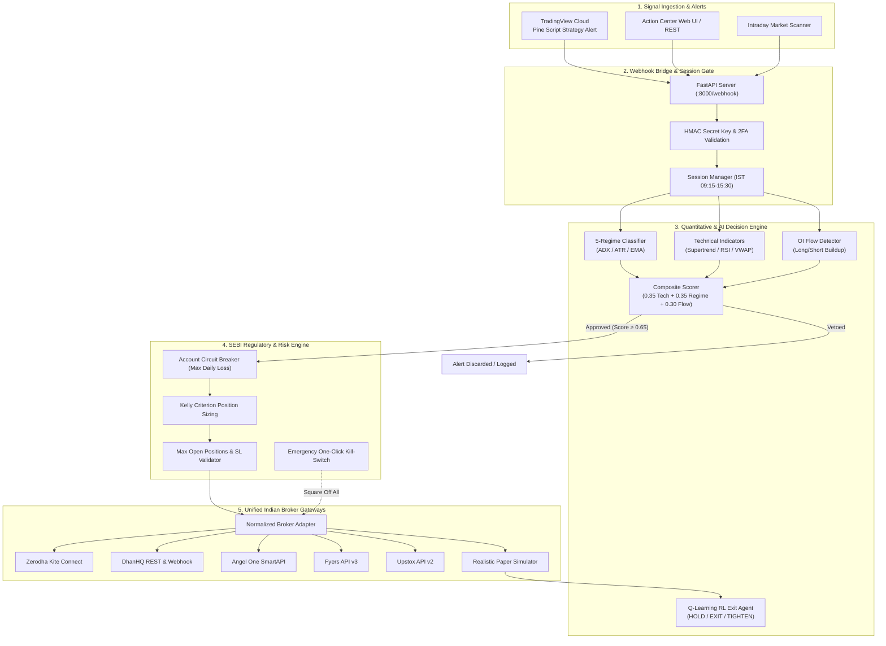

# BharatTrader-AI 🇮🇳
### Autonomous Unified Algorithmic & AI Live Trading Engine for Indian Markets (NSE / BSE / F&O)

BharatTrader-AI is a unified, production-grade algorithmic trading repository synthesizing the best architectural designs, quantitative analytics, and AI reasoning engines from leading open-source Indian trading ecosystems:
- **`openalgo`**: Normalized multi-broker REST API, TradingView/ChartInk webhook receiver, and Action Center.
- **`fenix`**: Standardized multi-broker adapters (Zerodha Kite, Dhan, Angel One, Upstox, Fyers).
- **`openbull`**: Pure-math Black-76 Options Greeks (Delta, Gamma, Vega, Theta, Rho, bisection IV solver), and Max Pain calculation.
- **`AI-trader`**: 5-Regime Market Classifier (`TRENDING_BULL`, `TRENDING_BEAR`, `SIDEWAYS`, `HIGH_VOLATILITY`, `LOW_VOLATILITY`), Tabular Q-Learning Reinforcement Learning Exit Agent (`RLExitAgent`), and composite multi-factor scoring.
- **`Agentic-Trader`**: Multi-agent LLM reasoning sentinel (Groq, Cerebras, OpenAI, Ollama).
- **`warrenduffer`**: Strict Asian/Kolkata (IST) market clock lifecycle, 15:15 IST mandatory intraday auto-square-off, and circuit breaker risk halts.

---

## 🏛️ System Architecture



---

## 🚀 Quick Start

### 1. Environment Setup
```powershell
# Create virtual environment and install dependencies
uv venv
.\.venv\Scripts\activate
uv pip install -r requirements.txt
```

### 2. Verify Analytics & Risk Engine
Run the automated test suite covering Greeks, IV solver, Max Pain, Regime Detection, and Risk rules:
```powershell
.\.venv\Scripts\python.exe -m pytest tests/ -v
```

### 3. Test CLI Diagnostics
```powershell
# 1. Compute Black-76 Greeks & Implied Volatility
.\.venv\Scripts\python.exe main.py --test-greeks

# 2. Test Market Regime Detector
.\.venv\Scripts\python.exe main.py --test-regime

# 3. Simulate an End-to-End TradingView Signal Order
.\.venv\Scripts\python.exe main.py --test-signal
```

### 4. Start Live Webhook Server
```powershell
.\.venv\Scripts\python.exe main.py
```
*Server starts on `http://0.0.0.0:8000/webhook` ready to receive TradingView JSON alerts.*

---

## 📈 TradingView Setup

### In TradingView Pine Editor:
Use the provided tested Pine Script v5 strategy templates:
1. **`tradingview/pinescript_options_buyer.pine`**: Automated ATM Call/Put options buyer for NIFTY / BANKNIFTY with Supertrend & EMA filters.
2. **`tradingview/pinescript_strategy_template.pine`**: Generic equity / futures strategy with dynamic ATR-based stop loss and take profit.

### Alert Configuration:
- **Webhook URL:** `http://YOUR_SERVER_IP:8000/webhook` (or your Ngrok / Cloudflare Tunnel URL)
- **Message:** Paste the JSON alert payload containing your secret key:
```json
{
  "secret_key": "BHARAT_SECURE_KEY_REPLACE_ME_IN_PROD",
  "symbol": "NIFTY24OCT24500CE",
  "action": "BUY",
  "quantity": 25,
  "order_type": "MARKET",
  "price": 145.0,
  "stop_loss": 120.0,
  "take_profit": 195.0,
  "product": "INTRADAY",
  "strategy_name": "Supertrend_CE_Buyer"
}
```

---

## 🛡️ SEBI 2025/2026 Compliance Architecture

- **Retail DIY Compliance:** Follows SEBI guidelines permitting retail algorithmic trading for personal accounts (< 10 orders/sec).
- **Static IP Whitelisting:** Ready for broker console IP binding.
- **Mandatory RFC 6238 TOTP:** Automated 2FA generation with daily session management.
- **Circuit Breakers:** Auto kill-switch stops trading if cumulative daily loss exceeds `max_intraday_loss_inr`.
- **Mandatory 15:15 IST Square-Off:** Automatically closes all open intraday (MIS) positions before cash market close.

---

## 📂 Repository Directory Layout

```
trading ai agent/
├── analytics/                         # Merged from openbull
│   ├── black76_greeks.py              # Black-76 Greeks & bisection IV solver
│   ├── max_pain.py                    # Strike Max Pain & PCR
│   ├── option_chain.py                # Strike ladder resolver & symbol builder
│   └── oi_tracker.py                  # Open Interest flow (buildup/unwinding)
│
├── brain/                             # Merged from AI-trader & Agentic-Trader
│   ├── regime_detector.py             # 5-regime market classifier
│   ├── rl_exit_agent.py               # Q-Learning RL dynamic exit agent
│   ├── composite_scorer.py            # Multi-factor confidence scoring
│   └── indicators.py                  # Pure-math Supertrend, EMA, RSI, ATR, VWAP
│
├── core/                              # Merged from fenix & warrenduffer
│   ├── broker_base.py                 # Abstract Normalized Broker Class
│   ├── risk_engine.py                 # SEBI circuit breaker, Kelly sizing, kill-switch
│   ├── session_manager.py             # IST clock (09:15-15:30), 15:15 auto-square-off
│   └── brokers/
│       ├── __init__.py                # Broker factory
│       ├── zerodha_adapter.py         # Zerodha Kite Connect
│       ├── dhan_adapter.py            # DhanHQ REST & Webhook
│       ├── angel_one_adapter.py       # Angel One SmartAPI
│       ├── fyers_adapter.py           # Fyers API v3
│       ├── upstox_adapter.py          # Upstox API v2
│       └── alpaca_adapter.py          # Alpaca (US Equities & Crypto)
│
├── bridge/                            # Merged from openalgo
│   ├── webhook_server.py              # FastAPI TradingView alert server
│   ├── payload_models.py              # Pydantic JSON schemas
│   └── action_center.py               # Full-Auto vs Semi-Auto execution queue
│
├── config/
│   ├── config.yaml                    # Master configuration
│   └── symbols_universe.yaml          # Indices & liquid equities specifications
│
├── tradingview/
│   ├── pinescript_strategy_template.pine # Standard equity/futures strategy
│   └── pinescript_options_buyer.pine     # Automated ATM options buyer
│
├── tests/                             # Comprehensive unit test suite
│   ├── test_analytics.py
│   ├── test_brain.py
│   └── test_risk_and_execution.py
│
├── main.py                            # Unified CLI dashboard & master runner
└── requirements.txt                   # Complete Python dependencies
```
