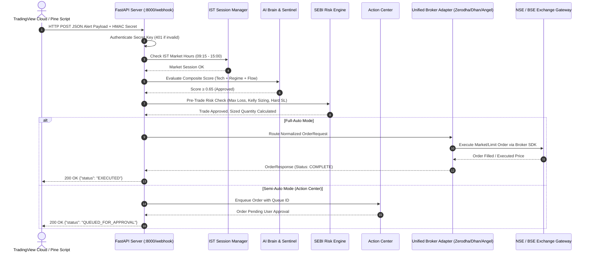

# BharatTrader-AI 🇮🇳
### Autonomous Unified Algorithmic & AI Live Trading Engine for Indian Markets (NSE / BSE / F&O)

BharatTrader-AI is a production-grade algorithmic and AI trading engine built specifically for the Indian financial markets. It synthesizes the best capabilities of top open-source quantitative and multi-broker repositories:
- **`openalgo`**: Standardized REST API, TradingView/ChartInk webhook listeners, and Action Center.
- **`fenix`**: Multi-broker Python adapters (**Zerodha Kite, Dhan, Angel One, Upstox, Fyers**).
- **`openbull`**: Pure-math Black-76 Options Greeks (Delta, Gamma, Vega, Theta, Rho, bisection IV solver), and Max Pain calculation.
- **`AI-trader`**: 5-Regime Market Classifier (`TRENDING_BULL`, `TRENDING_BEAR`, `SIDEWAYS`, `HIGH_VOLATILITY`, `LOW_VOLATILITY`), Tabular Q-Learning Reinforcement Learning Exit Agent (`RLExitAgent`), and multi-factor scoring.
- **`Agentic-Trader`**: Multi-agent LLM reasoning sentinel (Groq, Cerebras, OpenAI, Ollama).
- **`warrenduffer`**: Strict Asian/Kolkata (IST) market clock lifecycle, 15:15 IST mandatory intraday auto-square-off, and circuit breaker risk halts.

---

## 📖 How It Works: Complete End-to-End Pipeline

The engine operates on a decoupled **5-Stage Pipeline** to ensure millisecond execution speed while maintaining institutional risk guardrails and intelligent AI confirmation:



### Detailed Component Functions:

1. **The Ingestion Bridge (`bridge/webhook_server.py`)**:
   - Listens on `http://0.0.0.0:8000/webhook`.
   - Validates the incoming `secret_key` against `config/config.yaml`.
   - Protects your system from unauthorized or spoofed webhook alerts.

2. **The Session Manager (`core/session_manager.py`)**:
   - Enforces Asia/Kolkata (IST) market timing.
   - **09:15 IST**: Market opens for fresh entries.
   - **15:00 IST**: Fresh entry cutoff (no new intraday trades allowed).
   - **15:15 IST**: Mandatory automated square-off for all MIS/intraday positions.
   - **RFC 6238 TOTP**: Automatically generates 6-digit 2FA codes for headless broker logins.

3. **The AI Brain & Sentinel (`brain/`)**:
   - **Market Regime Classifier (`regime_detector.py`)**: Continuously categorizes the market into `TRENDING_BULL`, `TRENDING_BEAR`, `SIDEWAYS`, `HIGH_VOLATILITY`, or `LOW_VOLATILITY`.
   - **Composite Scorer (`composite_scorer.py`)**: Evaluates `0.35 * Technicals + 0.35 * Regime + 0.30 * Flow`. If composite confidence is `< 0.65`, the trade is vetoed to prevent whipsaws.
   - **Reinforcement Learning Exit Agent (`rl_exit_agent.py`)**: A tabular Q-Learning agent with an 8-feature state vector that decides whether to `HOLD`, `EXIT`, or `TIGHTEN` stop-losses dynamically based on price momentum and unrealized PnL.

4. **The SEBI Regulatory & Risk Engine (`core/risk_engine.py`)**:
   - **Circuit Breaker**: Halts all trading and trips the kill-switch if cumulative daily loss reaches `max_intraday_loss_inr`.
   - **Kelly Criterion**: Dynamically sizes orders based on win probability ($p=0.55$) and payoff ratio ($b=1.5$), with a 0.5x Half-Kelly safety factor.
   - **Hard Stop-Loss**: Rejects buy orders if stop-loss is missing or positioned above entry price.
   - **Kill-Switch**: One-click endpoint (`POST /kill-switch`) that cancels open orders and liquidates all positions immediately.

5. **The Unified Broker Adapter (`core/brokers/`)**:
   - Seamlessly translates standardized `OrderRequest` models to broker-specific SDKs:
     - **Zerodha**: `kite.place_order(...)`
     - **Dhan**: `dhanhq.place_order(...)`
     - **Angel One**: `smartApi.placeOrder(...)`
     - **Fyers**: `fyers_model.place_order(...)`
     - **Upstox**: `order_api.place_order(...)`
     - **Paper Simulator**: Realistic tick execution with zero real capital risk.

6. **The Quantitative Options Analytics (`analytics/`)**:
   - **Pure-math Black-76 Greeks (`black76_greeks.py`)**: Calculates Delta, Gamma, Theta, Vega, and Rho without external compiled C-libraries.
   - **Bisection IV Solver**: Calculates Implied Volatility (IV) with guaranteed mathematical convergence.
   - **Max Pain & PCR (`max_pain.py`)**: Pinpoints the strike price where option sellers maximize profits, and tracks the Put-Call Ratio for macro sentiment.

---

## 🛠️ Step-by-Step Setup Guide

### 1. Prerequisites
- **Python 3.12+**
- **uv package manager** (or standard pip)
- Git

### 2. Installation
Clone or navigate to the repository and set up the virtual environment:
```powershell
cd "c:\Users\dhuri\Downloads\antigravity ai workspace\trading ai agent"

# Create virtual environment
uv venv
.\.venv\Scripts\activate

# Install required dependencies
uv pip install -r requirements.txt
```

### 3. Broker Configuration
Edit `config/config.yaml` to specify your preferred environment and broker:

```yaml
app:
  environment: "paper"  # "paper" for simulation, "live" for real exchange execution
  server_host: "0.0.0.0"
  server_port: 8000
  webhook_secret_key: "CHANGE_TO_A_SECURE_RANDOM_SECRET"
  execution_mode: "full_auto"  # "full_auto" or "semi_auto"
  enable_ai_sentinel: true

risk:
  max_intraday_loss_inr: 5000.0        # Daily loss circuit breaker
  max_capital_per_trade_percent: 5.0   # Max % equity per trade
  max_open_positions: 3                # Max concurrent positions
  enforce_hard_stop_loss: true

brokers:
  active_broker: "zerodha"  # Options: 'zerodha', 'dhan', 'angel_one', 'fyers', 'upstox'

  zerodha:
    api_key: "YOUR_ZERODHA_API_KEY"
    api_secret: "YOUR_ZERODHA_API_SECRET"
    user_id: "YOUR_ZERODHA_USER_ID"
    totp_secret: "YOUR_BASE32_TOTP_KEY"
    access_token: "YOUR_DAILY_ACCESS_TOKEN"

  dhan:
    client_id: "YOUR_DHAN_CLIENT_ID"
    access_token: "YOUR_DHAN_ACCESS_TOKEN"

  angel_one:
    api_key: "YOUR_SMARTAPI_KEY"
    client_code: "YOUR_CLIENT_CODE"
    password: "YOUR_PIN_OR_PASSWORD"
    totp_secret: "YOUR_BASE32_TOTP_KEY"
```

---

## 📡 TradingView Webhook Connection

### 1. Make Your Server Publicly Accessible
Since TradingView cloud servers send HTTP POST alerts, your local server must be reachable. You can use **Ngrok** or **Cloudflare Tunnels**:
```powershell
# Using ngrok to expose port 8000
ngrok http 8000
```
This gives you a public URL such as `https://xxxx-xx-xx.ngrok-free.app`.

### 2. Add Pine Script Strategy in TradingView
1. Open [TradingView](https://www.tradingview.com/) and navigate to the **Pine Editor** tab at the bottom.
2. Paste the contents of [`tradingview/pinescript_options_buyer.pine`](file:///c:/Users/dhuri/Downloads/antigravity%20ai%20workspace/trading%20ai%20agent/tradingview/pinescript_options_buyer.pine) (for automated NIFTY/BANKNIFTY options buying) or [`tradingview/pinescript_strategy_template.pine`](file:///c:/Users/dhuri/Downloads/antigravity%20ai%20workspace/trading%20ai%20agent/tradingview/pinescript_strategy_template.pine).
3. Click **Add to Chart**.
4. In the strategy settings, paste your `webhook_secret_key` matching `config/config.yaml`.

### 3. Create the Alert
1. Click the **Alert** button on TradingView (or `Alt + A`).
2. Set **Condition** to the added Strategy.
3. Check **Webhook URL** and enter:
   ```
   https://xxxx-xx-xx.ngrok-free.app/webhook
   ```
4. Set **Message** to:
   ```json
   {
     "secret_key": "CHANGE_TO_A_SECURE_RANDOM_SECRET",
     "symbol": "NIFTY24OCT24500CE",
     "action": "BUY",
     "quantity": 25,
     "order_type": "MARKET",
     "price": 140.0,
     "stop_loss": 115.0,
     "take_profit": 190.0,
     "product": "INTRADAY",
     "strategy_name": "Supertrend_Options_Buyer"
   }
   ```
5. Click **Create**. Every time your strategy fires a signal, it routes directly to BharatTrader-AI!

---

## 🧪 Automated Testing & Verification

The repository includes a comprehensive, automated test suite:

### 1. Run All Automated Tests in One Command
```powershell
.\.venv\Scripts\python.exe scripts/run_automated_tests.py
```
This script automatically executes:
- **Pytest Suite**: 20 comprehensive unit and end-to-end integration tests.
- **Greeks Diagnostic**: Verifies Black-76 theoretical pricing, Greeks, and IV solver.
- **Regime Diagnostic**: Verifies trend and volatility classification.
- **Signal Diagnostic**: Simulates an incoming TradingView signal and verifies broker routing.

### 2. Run Pytest Directly
```powershell
.\.venv\Scripts\python.exe -m pytest tests/ -v
```

### 3. Individual CLI Diagnostic Flags
```powershell
# Test Black-76 Options Greeks & IV
.\.venv\Scripts\python.exe main.py --test-greeks

# Test 5-Regime Market Classifier
.\.venv\Scripts\python.exe main.py --test-regime

# Simulate a Test Webhook Signal
.\.venv\Scripts\python.exe main.py --test-signal
```

---

## 🕹️ Action Center (Full-Auto vs Semi-Auto)

In `config/config.yaml`, you can configure the execution mode:
- **`full_auto`**: Signals from TradingView are validated by the AI Sentinel and Risk Engine, then placed directly on the exchange in milliseconds.
- **`semi_auto`**: Signals are held in a pending queue in the Action Center. A human trader can review them and approve or reject them via REST endpoints:
  - List pending trades: `GET /action-center/pending`
  - Approve a trade: `POST /action-center/approve/{queue_id}?secret_key=YOUR_KEY`

---

## 🚨 Emergency Kill-Switch

If market conditions turn extreme or you want to instantly exit all positions:
```powershell
# Send HTTP POST to kill-switch
curl -X POST "http://localhost:8000/kill-switch?secret_key=YOUR_SECRET_KEY"
```
This immediately:
1. Trips the internal circuit breaker (halting any further order entry).
2. Cancels all pending orders across the broker terminal.
3. Places market exit orders to square off all open positions.
